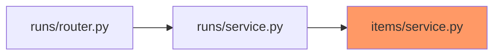

# Pull request descriptions

A pull request description prepares the review. The reviewer reads it before
the diff, so it says what changed, what to check, and where to start reading.
It doesn't retell the work.

## Rules

- **Never invent content.** Write only what you know from the spec, the
  reports of the agents you dispatched, or reading the code now. If you don't
  know something, leave it out. A plausible section you made up sends the
  reviewer to the wrong places, and it reads as if it were checked.
- **Leave out empty sections.** A section with nothing real to say is omitted,
  not filled.
- **Trivial pull requests** (a rename, formatting, a few lines) get one
  sentence instead of the template.
- **Keep it short.** One screen per pull request, two at most.

## Where the files go

Write one file per pull request to `.git/pr-descriptions/<NN>-<branch>.md` in
the repository, numbered in review order. Git never tracks its own directory,
so the files can't end up in a commit. Then hand the user the commands that use
them, for example `gh pr edit <branch> --body-file .git/pr-descriptions/01-<branch>.md`.
Don't run `gh` yourself.

When review fixes change a pull request, rewrite its file and hand over the
matching `gh pr edit` command.

## Stacked pull requests

For a stack, also write `.git/pr-descriptions/00-series.md`: the review and
merge order, one line per pull request saying what it does, and which pull
requests depend on which. The user posts it as a comment on the first pull
request (`gh pr comment <first-branch> --body-file …`).

## Sections

In this order. Each heading carries the source of its content in brackets.

### Intent  [spec]

One sentence: what behaves differently after this pull request. Describe
behavior, not "refactored X".

### Decisions

- Links to the decision records this pull request adds (see "Decision
  records" in `~/.claude/coding_guides/documentation.md`), each with its
  one-line summary and its `decided-by`.
- Decisions that only matter for reviewing this change, one line each, with
  where they were made: `[implementer]`, `[reviewer]` or `[test]`.

Decisions already in the spec don't belong here; the reviewer has read the
spec.

### Behavior the spec left open  [diff]

Start the section with this line, so any reader knows how to use it:

*For each item, decide before reading the diff: right, wrong (needs a fix), or
unclear (check it in the code).*

Then 3–8 items, prefixed Input, Output, Errors or Limits. Each item must be:

- **observable:** what a caller or user sees, not how the code does it;
- **not in the spec:** check the spec before listing an item;
- **judgeable without the code:** someone who hasn't read the diff can decide
  whether it's right.

An item that passes the test for a decision record belongs in a record and
under Decisions instead.

### Architecture invariants  [ARCHITECTURE.md]

Only the `**Architecture Invariant:**` and `**API Boundary:**` markers in
`docs/ARCHITECTURE.md` for the components this pull request touches. Never
inferred ones. Omit the section if the repository has no ARCHITECTURE.md.

- Touched: <invariant>, at `path:line` (the change is in code this invariant
  governs; the reviewer checks it)
- Changed: <invariant>, ARCHITECTURE.md updated: yes/no
- Added: <invariant>

Don't give a verdict such as "still holds". The reviewer checks; the list says
what to check.

### Contract changes  [diff]

What callers of the API or CLI, or developers working on the code, must now
handle or do differently: fields added to a response, a parameter no longer
required, "a model change now needs a migration revision".

### Blast radius  [diff]

Code outside this pull request that uses what it changes.

- **Direct:** every file that uses a changed symbol, naming the symbol and
  what changed about it. A file that imports the module but only uses
  unchanged symbols isn't listed. With more than about ten files, group them
  by package with a count.
- **Entry points reached:** every entry point (CLI command, endpoint,
  scheduled job, skill) the change reaches at any depth, each with the path it
  goes through.
- **Further:** everything else as a single count.
- **Not visible to static analysis:** dynamic imports, registries, references
  by name in text (a skill calling a command), configuration wiring. Name the
  ones that apply.

With at least four nodes, add a Mermaid graph; above about twelve, leave it
out and say so. Arrows point from the code that uses something to what it
uses; mark changed nodes.

````markdown

````

Omit the section if no code outside the pull request uses what it changes.

### Call order  [diff]

Only when the pull request changes code on a runtime path. One tree per entry
point the pull request touches (CLI command, service start, endpoint).

- Nesting shows calls: an indented line runs inside the call above it; lines
  at the same depth run in that order. Use tree glyphs (├─ └─ │).
- Show project code down to where the pull request's units are, plus the
  library steps that call back into project code (e.g. Alembic executing
  env.py). Collapse repeats into "(same as in …)".
- Mark units: ★ new, ✎ changed, with a short trailing comment saying what
  changed. Label units from other pull requests in the stack ("comes with
  PR 2").
- Build the tree from the code itself, not from memory, so that nested calls
  aren't flattened into a sequence.

### Reading path  [diff]

3–6 steps, in the order that builds understanding, each with `path:line`, why
to read it, and what to check there.

1. **Documentation first.** Changes to ARCHITECTURE.md, the README and the
   decision records listed under Decisions are step 1: they summarize the
   code change.
2. **Generated files aren't stops.** Point to the source they're generated
   from (the models, not the migration). Point into a generated file only
   where it was edited by hand.

End the section with every changed file not on the path:

```markdown
Other changed files:
- `path`: <what the file is, and why it isn't a stop>
```

Write these lines for a reader who doesn't know the tool or library ("Alembic's
template for new revision files, unchanged from the default").

### Open questions

Only what is still unresolved now. Something fixed later in the stack doesn't
belong here. Tag each item with who found it:

- `[reviewer]`: a reviewer agent's finding that wasn't fixed
- `[test]`: a result or a gap from a test or scenario run
- `[implementer]`: an uncertainty the agent that wrote the code stated
- `[pr-writer]`: something you noticed while writing this description

```markdown
Needs your decision:
- [reviewer] <finding>, <why it needs a decision>
For information:
- [test] <untested path or result>
```
